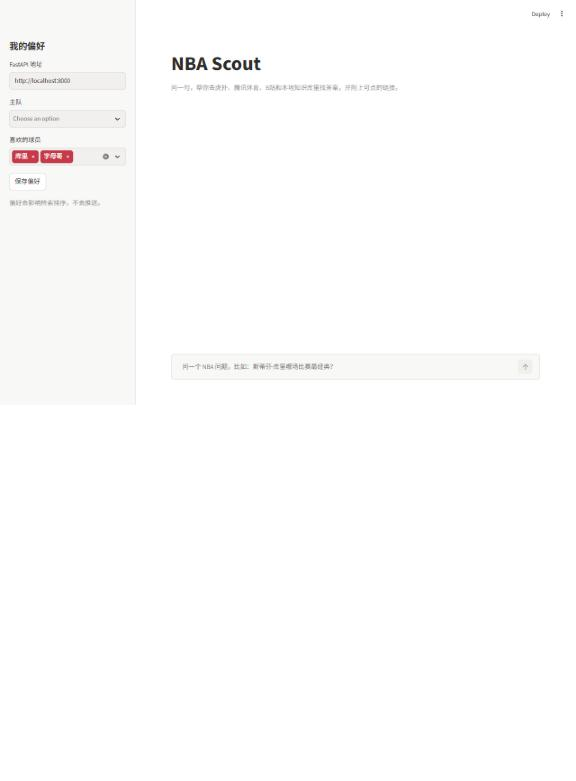
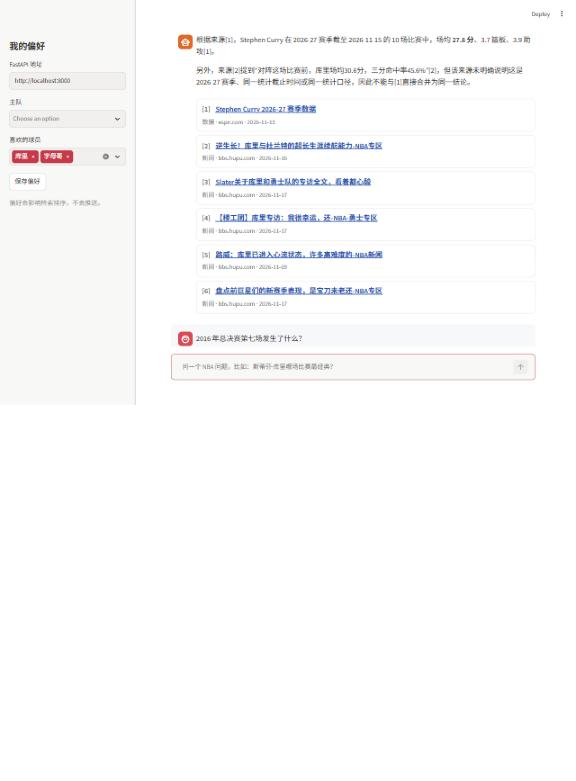

# NBA Scout — Agentic RAG NBA 问答助手

[](https://github.com/Sev7nx/nba-agentic-rag/actions/workflows/ci.yml)

用一句中文提问，Agent 自己决定去结构化数据、新闻搜索还是视频搜索找答案，返回带引用和可点击来源的中文回答。

项目目标：个人使用 + AI 应用开发岗位简历项目。核心不是「查数据」，而是「帮你找」：把分散在虎扑、腾讯体育、B站和本地资料里的信息，变成一句回答加一组链接。

数据原则：**数字走 SQL，解释走向量检索**。球员场均、球队战绩、奖项、得分王这类精确数据直接查 `data/stats.sqlite`，不把数字切块塞进向量库；新闻、比赛回顾、球员介绍、规则和战术这类非结构化内容才走向量 RAG。

| 首页与偏好 | 回答、引用与来源卡片 |
|---|---|
|  |  |

来源卡片会显示与正文 `[n]` 对应的编号、来源类型（数据/比分/新闻/文档/视频）、站点和日期；点标题直接打开原文。回答下方的「调试轨迹」会展开每个阶段的耗时和模型成本。

## 架构

```
Streamlit UI
  │  HTTP / SSE
  ▼
FastAPI 后端（/api/chat、/api/chat/stream、/api/profile、/docs）
  │
  ▼
LangGraph Agent
  analyze_plan → execute_tools → grade_evidence → synthesize → verify
                                   │
       ┌───────────────┬───────────┼────────────┬──────────────┐
       ▼               ▼           ▼            ▼              ▼
   stats_query     live_query   search_news  search_videos   doc_search
  data/stats.sqlite nba_api.live  Tavily       Tavily         Chroma + BGE
  1947–2026-27      今日比分      新闻/转会     B站/YouTube    文档 RAG
       │
       └─ 精确数字：球员赛季/生涯、球队战绩、奖项、得分王
```

## 功能

- 中文聊天界面，SSE 流式输出
- 查询分析与规划：一次 LLM 调用同时输出实体、意图、时效性、歧义和 1–4 个工具计划
- 最多 4 个工具调用、2 轮检索
- 多源检索：结构化统计、今日比分、新闻、视频、网页正文
- 结构化数据精确查询：球员赛季/生涯、球队战绩、奖项、得分王；数字走 SQL，不做向量检索
- 当前赛季每日刷新：ESPN 球员数据 + Kaggle TeamStatistics，自动更新 `as_of`
- 今日比赛/实时比分：`nba_api.live`，30 秒缓存
- 文档 RAG：Chroma + BGE-small-zh，按文档类型过滤 + 实体加权；可切 BGE-M3 / BGE-reranker
- 证据去重、来源质量评分、结构化证据优先、BGE 重排（可选）
- 带行内引用 `[n]` 和可点击来源卡片
- 自检：引用覆盖、链接可达、无来源不编造
- 主队 / 喜欢的球员设置，影响检索排序
- SQLite 缓存 + slowapi 限流
- 24 题评测集（新闻 / 历史 / 对比 / 视频 / 规则 / 结构化统计 / 实时比分）+ 指标报告

## 技术栈

Python 3.11、FastAPI、Pydantic、Streamlit、LangGraph、DeepSeek/Qwen（OpenAI 兼容）、Tavily、SQLite、nba_api、Chroma、BGE-small-zh（可切 BGE-M3）/ BGE-reranker（可选）、pytest、Docker Compose。

## 快速开始

### 1. 安装

```bash
python -m venv .venv
source .venv/Scripts/activate
pip install -e ".[dev,embeddings,data]"
```

PowerShell：

```powershell
.venv\Scripts\Activate.ps1
pip install -e ".[dev,embeddings,data]"
```

### 2. 配置

```bash
cp .env.example .env
```

编辑 `.env`：

```
LLM_API_KEY=你的模型 key
LLM_BASE_URL=https://api.deepseek.com
LLM_MODEL=deepseek-flash
TAVILY_API_KEY=你的 Tavily key
STATS_AS_OF=2026-11-01
```

`STATS_AS_OF` 是历史快照的回退日期；`refresh_stats.py` 会把最新截止日写进 `stats.sqlite` 的 `meta` 表，通常不用手动改。

### 2.1 检查环境

```bash
python scripts/check_setup.py
```

它会检查 Python 版本、`.env`、两个 API key、`stats.sqlite`、文档 JSONL 和 Chroma 索引；缺什么会打印下一步命令。不会调用 API，也不会打印 key 的值。

### 3. 准备结构化数据

项目用 [sumitrodatta/nba-aba-baa-stats](https://www.kaggle.com/datasets/sumitrodatta/nba-aba-baa-stats) 的历史数据（1947–2026-27，含球员赛季/生涯、球队战绩、奖项、全明星、最佳阵容）建 SQLite：

```bash
kaggle datasets download -d sumitrodatta/nba-aba-baa-stats -p data/extra --unzip
python scripts/build_stats_db.py
```

生成 `data/stats.sqlite`。需要先配置 Kaggle CLI（`~/.kaggle/kaggle.json`）。

### 3.1 刷新当前赛季

sumitrodatta 快照最后更新是 2026-11-01；当前赛季用 ESPN 球员数据 + 每日更新的 [TeamStatistics](https://www.kaggle.com/datasets/eoinamoore/historical-nba-data-and-player-box-scores) 覆盖到最近比赛日：

```bash
python scripts/refresh_stats.py --skip-download
```

第一次运行会下载约 35MB 的 `TeamStatistics.csv`；之后可以用 `--skip-download` 使用缓存，或：

```bash
python scripts/refresh_stats.py --refresh
```

脚本会更新 `data/stats.sqlite` 里 2026-27 的球员/球队行，并把实际截止日写进 `meta.as_of`；回答里的「数据截至」会自动跟着变。

### 4. 构建文档索引

先用 Tavily 抓取公开文档（输出 `data/docs/documents.jsonl`）：

```bash
python scripts/fetch_docs.py
```

再切块、embedding 并写入 Chroma：

```bash
python scripts/build_doc_index.py
```

首次运行会下载 `BAAI/bge-small-zh-v1.5`（约 100MB），需要一些时间和磁盘空间。国内网络可在命令前加代理，例如：

```bash
HTTPS_PROXY=http://127.0.0.1:17890 python scripts/build_doc_index.py
```

想要更强的多语言检索，可以把 `.env` 里的 `EMBEDDING_MODEL` 改成 `BAAI/bge-m3`（约 2GB）并重建索引；换 embedding 模型后必须重建。`RERANK_ENABLED=true` 时会额外下载并预热 `BAAI/bge-reranker-base`；只想快速验证保持 `false`。重建会删除旧的 `nba_docs` collection。

### 5. 启动

```bash
uvicorn app.main:app --reload
```

另开一个终端：

```bash
streamlit run app/ui/streamlit_app.py
```

打开 `http://localhost:8501`；API 文档在 `http://localhost:8000/docs`。

## 从零复现

按顺序执行：

```bash
python -m venv .venv
source .venv/Scripts/activate
pip install -e ".[dev,embeddings,data]"
cp .env.example .env
python scripts/check_setup.py

kaggle datasets download -d sumitrodatta/nba-aba-baa-stats -p data/extra --unzip
python scripts/build_stats_db.py
python scripts/refresh_stats.py --skip-download

python scripts/fetch_docs.py
python scripts/build_doc_index.py
python scripts/check_setup.py

uvicorn app.main:app --reload
streamlit run app/ui/streamlit_app.py
```

常见问题：

- `kaggle: command not found`：先安装 Kaggle CLI，并把 `kaggle.json` 放到 `~/.kaggle/`。
- BGE 模型下载慢或失败：给 `build_doc_index.py` 加代理，例如 `HTTPS_PROXY=http://127.0.0.1:17890 python scripts/build_doc_index.py`。
- 没有 `data/chroma` 或文档检索为空：重新运行 `python scripts/build_doc_index.py`；换 embedding 模型后必须重建。
- `data/nba.sqlite` 是旧 nbadb 数据，当前未使用，可以删除以释放约 2.2GB。
- Docker Compose 会挂载本地的 `./data`，启动前先按上面的步骤准备好 `data/`。

## 演示

启动 API 和 Streamlit 后，按下面 5 个问题走一遍，能覆盖所有数据源：

| 问题 | 观察点 |
|---|---|
| 库里 2026-27 赛季场均多少分？ | 数字来自 `stats.sqlite`，来源卡片编号与正文 `[1]` 对应 |
| 2016 年总决赛第七场发生了什么？ | 文档 RAG + 视频来源，回答按来源分点 |
| 勇士最近有什么交易传闻？ | 新闻搜索，多个来源冲突时会同时呈现 |
| 找几个库里的三分集锦。 | B站/视频来源，标题可点击 |
| 今天有什么比赛？ | `nba_api.live` 实时比分，比分来源类型显示为「比分」 |

演示时建议按这个顺序讲：

1. 先问一个统计题，说明「数字走 SQL，不走向量检索」；
2. 再问一个历史/新闻题，说明多源路由和证据合并；
3. 打开「调试轨迹」，指出 analyze / plan / 工具 / synthesize 各阶段耗时和单题成本；
4. 最后说明评测结果和 P95 未达标的取舍。

## Docker

```bash
docker compose up --build
```

打开 `http://localhost:8501`。api 在 `http://localhost:8000`。

镜像包含 BGE 依赖，第一次构建会比较慢、体积较大。没有 Docker 时，用上面的本地启动方式即可。

## 评测

```bash
python scripts/eval.py --limit 5          # 用真实模型和搜索
python scripts/eval.py --limit 3 --fake   # 不调 API，检查报告格式
```

生成 `eval/report.md`，指标包括：

- `retrieval_hit_rate`：期望来源是否出现
- `citation_coverage`：关键事实是否有引用
- `link_validity`：来源链接是否有效
- `p95_latency_ms`：端到端延迟
- `avg_cost_cny`：单次问答平均成本

目标：命中率 ≥ 70%，引用覆盖 ≥ 90%，链接有效 ≥ 95%，P95 < 10 秒，单次成本 < 0.2 元。

最近一次真实评测（2026-11-18，24 题，DeepSeek + Tavily，65 篇文档 / 810 chunks）：

| 指标 | 结果 | 目标 |
|---|---:|---:|
| retrieval_hit_rate | 1.000 | ≥ 0.70 |
| citation_coverage | 1.000 | ≥ 0.90 |
| fact_hit_rate | 1.000 | — |
| link_validity | 1.000* | ≥ 0.95 |
| p95_latency_ms | 18,718 | < 10,000 |
| avg_cost_cny | 0.0119 | < 0.20 |

\* 死链在返回前丢弃，`link_validity` 只统计返回的可用链接。

P95 还没达到 10 秒目标。当前平均端到端约 12.5 秒，主要瓶颈是外部检索（单题峰值约 15.7 秒）、synthesize（平均约 5.2 秒）和 analyze_plan（平均约 3.8 秒）。已做的优化：合并 analyze+plan、链接检查从 4 路并发提到 8 路、回答更简洁但保留关键数字和球员姓名。下一步可以让结构化统计走确定性 fast path，或对外部检索加更细的超时和降级。

把真实跑出来的结果填到 README 或简历里；不要用 `--fake` 的数字冒充真实指标。

## 项目结构

```
app/
  main.py            FastAPI 路由、SSE、限流
  models.py          Pydantic 模型
  agent/             查询分析、规划、执行、评分、自检
  tools/             搜索、正文提取、结构化统计、今日比分、文档 RAG
  rag/               语料切块、embedding、重排
  services/          ChatService、profile、缓存
  ui/                Streamlit 页面与组件
tests/               单元测试 + API 测试 + e2e
eval/                评测问题和报告
scripts/             环境检查、建索引、刷新数据、跑评测
docs/                设计文档和实现计划
```

## 设计取舍（面试可以讲）

- **为什么 Agentic RAG，而不是普通 RAG**：问题需要多源路由（结构化数据 / 新闻 / 视频 / 文档），还要在证据不足时改写查询重试。普通 RAG 只做一次检索，覆盖不了这种问题。
- **为什么不把数字做成向量**：场均得分这种精确值需要 SQL 计算和聚合，向量检索只能找到「提到过数字的段落」，既不准也难更新。数字走 SQL，解释类内容走向量，最后合并证据。
- **为什么用 LangGraph**：状态机显式、可调试，后续可以加 Planner/Critic 演进到多 Agent。
- **检索质量**：切块 + 元数据（doc_type/来源/日期）+ 向量检索 + doc_type 过滤 + 实体加权 + 可选 BGE 重排 + 来源质量评分。
- **防幻觉**：每个关键事实带引用；没有来源就明确说没找到；自检不过最多重试一次。
- **成本与延迟**：缓存、并行工具、最多 4 次调用 / 2 轮检索、便宜模型；问题分析和检索规划合并成一次 LLM 调用，链接检查 8 路并发，回答简洁但保留关键数字和球员姓名。
- **评测**：24 题评测集 + 自动指标，而不是「我觉得挺好」。

## 已知限制

- 历史数据来自 sumitrodatta 快照（最后更新 2026-11-01）；当前赛季由 `refresh_stats.py` 从 ESPN + Kaggle TeamStatistics 刷新，通常比当天晚 1–2 天，今天/进行中的比赛用 `live_query`。
- 今日比分来自 `nba_api.live`；NBA 官方 stats 接口在部分网络会被 Akamai 拦截，所以历史统计用离线快照，不依赖在线 stats 接口。
- nbadb 的 Kaggle 版本是原始 16 表、数据只到 2023，暂未作为主数据源；历史统计以 sumitrodatta 为底，当前赛季由 `refresh_stats.py` 覆盖。
- 单用户，无登录；公网 demo 需要限流。
- 文档索引需要先用 Tavily 抓取语料并重建；首次运行会下载 BGE 模型。
- 视频搜索优先 B站；YouTube 作为回退，国内网络可能不可达。
- B站/YouTube 链接可能受地区限制，UI 会标记或丢弃失效链接。